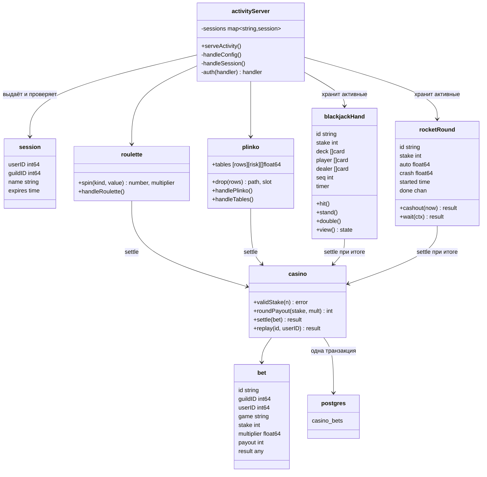
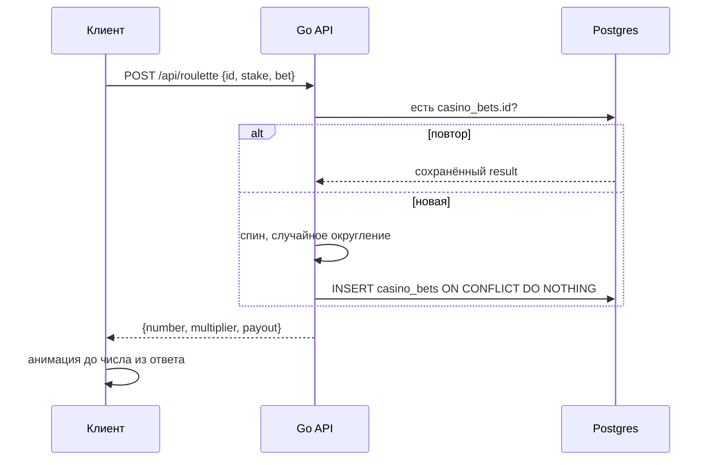

# Implementation Plan: Казино-игры в Discord Activity

**Branch**: `001-activity-casino-games` | **Date**: 2026-11-09 | **Spec**: [spec.md](spec.md)

**Input**: Feature specification from `/specs/001-activity-casino-games/spec.md`

## Summary

Четыре игры (рулетка с зеро, Plinko, блэкджек, рокетка) как Discord Activity. Веб-страница на TypeScript + canvas, игровой HTTP API внутри существующего Go-процесса бота. Результат определяет только сервер и пишет в новую таблицу `casino_bets`. Ставки — в фантиках, игровой валюте без баланса: учёт отжиманий и статистика бота не меняются. Режим разработки позволяет играть в обычном браузере без настройки Discord и хостинга. Подробности решений — [research.md](research.md).

## Technical Context

**Language/Version**: Go 1.27 (сервер, существующий модуль); TypeScript 5 (фронтенд)

**Primary Dependencies**: Сервер — только стандартная библиотека + уже подключённые `discordgo`, `pgx`. Фронтенд — `@discord/embedded-app-sdk`, `vite`, `typescript`.

**Storage**: Postgres (Supabase): новая таблица `casino_bets`. Активные партии блэкджека, раунды рокетки и сессии — в памяти.

**Testing**: `go test` — математика без базы + один интеграционный тест в откатываемой транзакции (как `bot_test.go`).

**Target Platform**: Linux-сервер бота; клиент — iframe Discord (десктоп, веб, мобильные) и обычный браузер в режиме разработки.

**Project Type**: Бот + веб-сервис + веб-клиент.

**Performance Goals**: Ответ на ставку быстрее 300 мс без учёта сети; анимации 60 fps.

**Constraints**: Память процесса ≤ 100 МБ (лимит хостинга, `debug.SetMemoryLimit(70 МБ)`); 4 соединения с базой в пуле; без публичного HTTPS на этом этапе.

**Scale/Scope**: Один Discord-сервер, десятки игроков, единицы одновременных партий.

## Constitution Check

`.specify/memory/constitution.md` — незаполненный шаблон, поэтому проверка идёт по правилам пользователя:

| Правило | Статус |
|---|---|
| Architect-First: план с деревом файлов и схемой классов утверждён до кода | Ожидает утверждения (этот план + `architecture.md`) |
| Ponytail: без новых зависимостей и абстракций без нужды | ✅ Go — ноль новых зависимостей; фронтенд — 3 пакета; без фреймворка, без физического движка, без WebSocket |
| Одна проверка на нетривиальную логику | ✅ `casino_test.go` |
| Без комментариев в коде, логи объектами | ✅ учтено для реализации |
| Безопасность на границе доверия | ✅ результат и время только на сервере, проверка членства в сервере, режим разработки только по явной настройке |

Повторная проверка после Phase 1: нарушений нет, таблица Complexity Tracking не нужна.

## Project Structure

### Documentation (this feature)

```text
specs/001-activity-casino-games/
├── plan.md
├── research.md
├── data-model.md
├── quickstart.md
├── contracts/http-api.md
└── tasks.md             # /speckit-tasks
```

### Source Code (repository root)

```text
pushups-bot/
├── activity.go          # новый: HTTP-сервер, маршруты, сессии, вход Discord/dev, раздача статики
├── casino.go            # новый: проверка ставки, случайное округление, settle() — запись в casino_bets
├── roulette.go          # новый: спин и обработчик
├── plinko.go            # новый: таблицы по формуле, путь шарика, обработчики
├── blackjack.go         # новый: колода, подсчёт, дилер, партии в памяти, таймер, обработчики
├── rocket.go            # новый: точка взрыва, раунды в памяти, вывод, долгий опрос
├── casino_test.go       # новый: математика игр + интеграционный тест повтора
├── config.go            # +ActivityPort, ActivityDevUserID, ClientSecret, ActivityDir
├── db.go                # +таблица casino_bets в schema
├── main.go              # +запуск serveActivity(), если задан ACTIVITY_PORT
├── .env.example         # +переменные казино
├── .gitignore           # +activity/node_modules, activity/dist
└── activity/            # новый: фронтенд
    ├── package.json
    ├── tsconfig.json
    ├── vite.config.ts   # прокси /api → localhost:ACTIVITY_PORT
    ├── index.html
    └── src/
        ├── main.ts      # вход (SDK или dev), меню игр
        ├── api.ts       # fetch с базовым путем /api или /.proxy/api, токен, типы ответов
        ├── roulette.ts
        ├── plinko.ts
        ├── blackjack.ts
        ├── rocket.ts
        └── style.css
```

**Structure Decision**: Сервер остаётся плоским пакетом `main` в корне, как весь бот (по файлу на игру, как `dota.go`, `pubg.go`, `wheel.go`). Фронтенд — отдельная папка `activity/` со своим `package.json`, на Go-сборку не влияет.

### Схема



### Поток одной ставки



## Порядок реализации

1. Общая основа: `config.go`, `db.go`, `casino.go`, `activity.go` (сессии, режим разработки), `main.go`; фронтенд `main.ts`, `api.ts`.
2. Рулетка (US1) — первая проверка всего пути браузер → Go → база.
3. Plinko (US2).
4. Блэкджек (US3).
5. Рокетка (US4).
6. `casino_test.go` растёт вместе с каждой игрой.

## Complexity Tracking

Нарушений нет.
